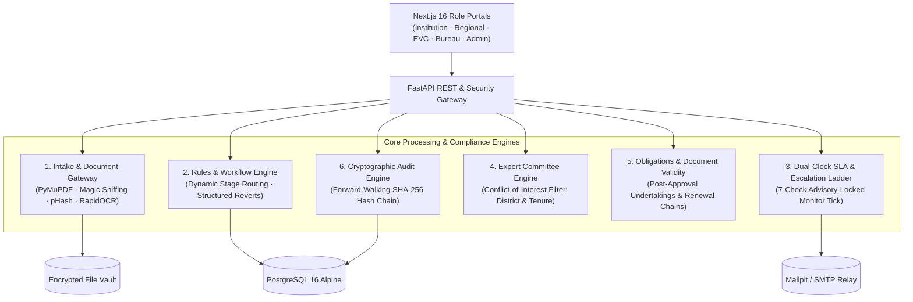

# ShadeX Control Tower — Enterprise Institutional Compliance & Regulatory Scrutiny Platform

> **Evidence-First Regulatory Governance, Intelligent Document Intake Gateway, Dual-Clock SLA Monitoring, and Tamper-Evident Cryptographic Audit Chaining.**

[](LICENSE)
[](#architecture)
[](https://www.postgresql.org/)
[](#tamper-evident-audit-trail)
[-brightgreen.svg)](#verification--test-suites)

---

## 1. Overview & System Mission

**ShadeX Control Tower** is an enterprise-grade compliance monitoring, document authentication, and statutory approval workflow platform designed for regulatory bodies and higher education governing authorities.

### Core Tenet: Assistive Governance, Never Autonomous Sanctions
The platform strictly enforces the human-in-the-loop principle:
- **Alerts, predictive routing, and document recommendations assist authorized officials.**
- **The system never approves, rejects, penalizes, or blocks an institution automatically.**
- Every statutory decision is signed by an authenticated officer via a cryptographic re-authentication challenge (`POST /sign` issuance of a 5-minute single-use `X-Sign-Token`) and permanently recorded into an append-only, SHA-256 hash-chained audit ledger.

---

## 2. Key Architecture Pillars



### 1. Intelligent Application Intake Gateway
- **Format Sniffing & Anti-Spoofing:** Enforces binary magic byte validation, completely ignoring untrusted HTTP `Content-Type` headers and file extensions (detects renamed PE executables and corrupted archives).
- **Safe Archive Decompression:** Hardened extraction algorithm defusing directory traversal exploits (`../escape.pdf`), ZIP bombs, symlinks, and excessive compression ratios.
- **Perceptual Duplicate Detection:** Dual-layer duplicate analysis combining exact SHA-256 collisions with 64-bit Discrete Cosine Transform (DCT) perceptual hashing (`pHash`) at a Hamming distance threshold $\le 5$.
- **Explainable Multi-Cue Classification:** Deterministic keyword and structural classifiers that map documents into confidence bands:
  - $\ge 0.75$: High-confidence auto-assignment.
  - $0.45 - 0.74$: Queued for manual officer scrutiny with highlighted textual cues.
  - $< 0.45$: Unclassified / unreadable, prompting re-upload.

### 2. Statutory Workflow & Scrutiny Engine
- **Dynamic Rule Routing:** Evaluates application types (New Institution, Extension of Approval, Intake Increase, Site Change) against versioned regulatory standards, dynamically computing approval paths:
  - *Only Scrutiny*
  - *Scrutiny + EVC*
  - *EVC + SAC/SHC*
  - *Scrutiny + EVC + SAC/SHC*
- **Structured Revert Loop:** Officers issue structured deficiency notices with category tags, specific clause references, and required remediation evidence. Reverts lock un-flagged fields to prevent un-scrutinized modifications and return directly to the issuing officer upon re-submission.
- **Password-Signed Decision Gates:** No officer can clear scrutiny, issue a revert, record an EVC outcome, or approve an application without entering their password into a modal challenge, issuing a single-use token verified server-side.

### 3. Dual-Clock SLA & Automated Escalation
- **Working-Day Accuracy:** Deadlines compute working business days against an active statutory holiday calendar and weekend pauses.
- **Seven-Check Background Monitor:** An independent scheduler daemon runs every 30 seconds behind a PostgreSQL session-level advisory lock (`pg_try_advisory_lock`):
  1. *Stage SLA Warning* triggered at 80% of window (e.g. Day 7.2 of a 9-day SLA).
  2. *Stage Overdue Flag* triggered at 100% of window (Day 9).
  3. *Level 1 Escalation* advanced to Regional Director after 48h unacknowledged.
  4. *Level 2 Escalation* advanced to Bureau Head (HQ) after 120h unacknowledged.
  5. *Document Expiry Warnings* dispatched at 90, 60, 30, and 7-day offsets.
  6. *Undertaking Compliance Deadlines* tracked and flagged.
  7. *Revert Response Deadlines* monitored.

### 4. Expert Visit Committee (EVC) Impartiality Engine
- **Automated Conflict-of-Interest Filtering:** Blocks assignment of expert panelists if:
  - The expert's registered home district matches the applicant institution's district.
  - The expert holds historical or current employment ties with the institution.
- **Pre-Visit Calendar:** Prioritizes pending visits by institutional application category and approaching academic session deadlines.

### 5. Undertaking Compliance & Document Lifecycle
- **Post-Approval Obligations Register:** Approval conditions automatically transform into tracked obligations.
- **Evidence Verification Gate:** Uploaded institutional evidence moves status to `Under Verification`. Only an officer's signed decision can promote it to `Verified`.
- **Document Expiry & Renewal Version Chaining:** Renewal leases and NOCs increment versions (`v1 -> v2`) while linking `parent_id` pointers, preserving full institutional compliance ancestry. Expiry clocks activate only after officer date confirmation.

### 6. Cryptographic Tamper-Evident Audit Trail
- Every administrative transaction computes a forward SHA-256 hash incorporating the previous node's hash, timestamp, actor ID, action verb, and canonical JSON payload:
  $$\text{Hash}_N = \text{SHA-256}\left(\text{Hash}_{N-1} \parallel \text{Timestamp} \parallel \text{User ID} \parallel \text{Action} \parallel \text{Entity ID} \parallel \text{Payload JSON}\right)$$
- An interactive **"Verify Chain"** utility performs a linear cryptographic check across all records (857 events verified in **28.81 ms**), instantly highlighting any unauthorized out-of-band database modification.

---

## 3. Repository & Workspace Organization

```
.
├── aicte-control-tower/            # Main Control Tower Web Application & API
│   ├── apps/
│   │   ├── api/                    # FastAPI Backend (SQLAlchemy 2, Alembic, Engines)
│   │   │   ├── app/
│   │   │   │   ├── engines/        # Workflow, Deadlines, Escalation, Monitor, Audit
│   │   │   │   ├── modules/        # Role-scoped endpoints (Applications, EVC, etc.)
│   │   │   │   └── scheduler/      # 30-second advisory-locked daemon
│   │   │   └── tests/              # 41 Integration and unit tests
│   │   └── web/                    # Next.js 16.4.3 App Router Frontend
│   │       ├── app/                # Portals: (marketing), (auth), (app)
│   │       ├── components/         # Design system tokens & Phosphor primitives
│   │       └── scripts/            # Playwright automation & typography audits
│   ├── docker-compose.yml          # Multi-container production topology
│   └── Makefile                    # Lifecycle automation targets
├── SIH 2026/                       # Intake Gateway & Document Processing Engine
│   ├── backend/                    # FastAPI Intake Microservice (PyMuPDF, RapidOCR)
│   ├── frontend/                   # Intake Workspace (Page-by-page inspection)
│   └── tools/                      # E2E synthetic testing and fuzzing suites
├── assets/                         # Consolidated Media & Visual Assets
│   ├── illustrations/              # 28 Production vector illustrations (.svg)
│   └── lottie/                     # 110+ Interactive keyframe animations (.json)
├── docs/                           # Architecture, Specifications & Governance
│   ├── reference-ui/               # Visual design references
│   ├── 00_START_HERE.md            # System guidelines & working rules
│   ├── 01_PRODUCT_SCOPE.md         # Role scopes & statutory boundaries
│   ├── 02_ARCHITECTURE.md          # Technical stack & schema blueprints
│   ├── 04_UI_UX_SPEC.md            # Typography, tokens & layout contracts
│   └── 05_PHASE_PLAN.md            # Phase gates & validation requirements
├── PERFORMANCE_METRICS_REPORT.md   # Full benchmark & latency distributions
├── RESULTS_AND_GRAPHS_REPORT.md    # SLA velocity gains & visual diagrams
├── SYNTHETIC_TEST_REPORT.md        # 18 Synthetic scenarios & attack simulations
├── .gitignore                      # Secrets & runtime artifact exclusion rules
└── README.md                       # Master platform documentation
```

---

## 4. Benchmark & Performance Summary

Comprehensive performance metrics were captured against a production-scale nationwide demonstration dataset (9 regions, 60 institutions, 304 applications, 460 stage instances, 60 obligations, 170 documents, 857 audit events):

| Benchmark Domain | Metric | Observed Value | SLA Standard | Status |
|---|---|---|---|---|
| **API Latency** | `GET /api/v1/health` | **6.05 ms** (P50) | < 50 ms | PASS |
| **API Latency** | `GET /api/v1/applications` | **15.87 ms** (P50) | < 100 ms | PASS |
| **API Latency** | `GET /api/v1/applications/{id}` | **67.25 ms** (P50) | < 250 ms | PASS |
| **Background Tick** | 7-Check Monitor Sweep | **1,085 ms** (P50) | < 5,000 ms | PASS |
| **Audit Verification** | 857 Chained Events Walk | **28.81 ms** (P50) | < 500 ms | PASS |
| **Doc Processing** | PyMuPDF Text Extraction | **9.06 ms** (5 pages) | < 50 ms | PASS |
| **Doc Processing** | SHA-256 Binary Hashing | **0.060 ms** / doc | < 1 ms | PASS |
| **Doc Processing** | Perceptual Hashing (pHash) | **77.07 ms** / page | < 150 ms | PASS |
| **Resource Usage** | Total 5-Service Stack RAM | **326.8 MiB** | < 1,024 MiB | PASS |
| **Frontend Vitals** | Lighthouse Accessibility | **100 / 100** | $\ge 90$ | PASS |
| **Typography Rule** | Nodes below 11.0 px | **0 violations** | 0 | PASS |

*For complete details, refer to [`PERFORMANCE_METRICS_REPORT.md`](file:///c:/Users/Omkar%20Ahirrao/Desktop/SIH%20Compliance/PERFORMANCE_METRICS_REPORT.md).*

---

## 5. Verification & Synthetic Test Scenarios

The test harness evaluates 18 comprehensive synthetic attack and edge-case scenarios (**115/115 passing tests** across both suites):

1. **Renamed Executable Injection:** Detects PE `MZ\x90\x00` payloads disguised with `.pdf` extension; rejected with `unsupported_signature`.
2. **Zip Path Traversal (Zip Slip):** Intercepts `../escape.pdf` directory climbing entries in zip archives; safely unpacks legitimate files.
3. **AES-256 Encrypted PDF:** Intercepts password-locked documents gracefully with `encrypted_pdf`.
4. **MIME & Extension Mismatch:** Corrects and flags JPEG-renamed PDFs through byte-level magic header inspection.
5. **Exact Binary Duplicate Detection:** Detects SHA-256 collisions across separate checklist submissions.
6. **Perceptual Duplicate Detection:** Catches visually modified copies using perceptual hashing (Hamming distance $\le 5$).
7. **Blank Camera Scan Routing:** Enforces human review routing (`needs_review = true`) for low-confidence raster uploads.
8. **Statutory EoA Bundle Validation:** End-to-end extraction and checklist satisfaction across 6 statutory document types.
9. **Reviewer Override Audit:** Preserves original AI predictions while logging reviewer corrections.
10. **Idempotency Guarantee:** Validates that repeated bundle processing never duplicates pages or extracted fields.
11. **Content-Addressed Manifest:** Generates versioned SHA-256 signed manifests with statutory disclaimer limits.
12. **Multi-Tenant Authorization:** Enforces strict HTTP 403 Forbidden on cross-institution data queries.
13. **EVC Conflict-of-Interest Filter:** Blocks appointment of same-district panelists with explicit rationale.
14. **Time Dilation Simulation:** Simulates Day 8 (Warning), Day 10 (Overdue + L1 Escalation), and Day 14 (L2 Escalation) via demo clock jumps.
15. **Digital Signature Enforcement:** Refuses unsigned statutory state mutations with HTTP 403.
16. **Undertaking Compliance Chaining:** Tracks obligation evidence submission, officer verification, and lease renewal versioning.
17. **Tamper-Evident Integrity Check:** Injects out-of-band SQL modifications into historical records, verifying immediate detection.

*For complete test execution logs, refer to [`SYNTHETIC_TEST_REPORT.md`](file:///c:/Users/Omkar%20Ahirrao/Desktop/SIH%20Compliance/SYNTHETIC_TEST_REPORT.md).*

---

## 6. Quickstart & Deployment Guide

### Prerequisites
- Docker Engine 24.x+ & Docker Compose v2
- Node.js 20 LTS (optional for host development)
- Python 3.11+ (optional for host development)

### 1. Launch with Docker Compose
```bash
# Clone the repository
git clone https://github.com/Nexus2005/ShadeX-SIH2026.git
cd ShadeX-SIH2026/aicte-control-tower

# Spin up all services (Database, API, Scheduler, Web, Mailpit)
docker compose up -d --build

# Verify healthy containers
docker compose ps
```

### 2. Service Access Points
- **Web Application Portal:** [http://localhost:3000](http://localhost:3000)
- **API Documentation (Swagger):** [http://localhost:8000/docs](http://localhost:8000/docs)
- **Mailpit SMTP Inspector:** [http://localhost:8025](http://localhost:8025)
- **Health Endpoint:** [http://localhost:8000/api/v1/health](http://localhost:8000/api/v1/health)

### 3. Demonstration Credentials

All accounts share the demonstration password: **`DemoPass!26`**

| Role Profile | Email Address | Portal Route | Primary Capabilities |
|---|---|---|---|
| **Institution Admin** | `institution@demo.controltower.in` | `/institution/overview` | File applications, upload evidence, answer reverts |
| **Regional Officer** | `regional@demo.controltower.in` | `/regional/overview` | Scrutiny review, issue reverts, verify undertakings |
| **EVC Coordinator** | `evc@demo.controltower.in` | `/evc/queue` | Schedule panels, conflict checks, record outcomes |
| **Bureau Officer** | `bureau@demo.controltower.in` | `/bureau/overview` | Nationwide oversight, signed approvals, L2 escalations |
| **System Admin** | `admin@demo.controltower.in` | `/admin/overview` | Rule publishing, calendar, user management, demo clock |

---

## 7. Interactive Demonstration Script

1. **Log in as Institution:** Navigate to `/institution/applications/new`. File an *Increase in Intake* application, attach required PDFs, and submit.
2. **Log in as Regional Officer:** Open the submitted case. Issue a **Structured Revert** specifying missing evidence. Note that un-flagged fields lock for the institution.
3. **Resubmit as Institution:** Upload the requested evidence and resubmit. The case returns immediately to the same officer.
4. **Clear Scrutiny:** As Regional Officer, click **Clear Scrutiny**, enter your password in the modal challenge to sign. The application auto-routes to the **EVC Queue**.
5. **Conflict-Free Scheduling:** Log in as EVC Coordinator. Open `/evc/queue`. Click **Schedule Visit**. Note that any expert from the institution's home district is disabled with a conflict explanation. Select an eligible expert and record the visit outcome.
6. **Final Approval with Undertakings:** As Bureau Officer, sign the approval and append two statutory undertakings.
7. **Simulate SLA Time Jumps:** Click the **Demo Clock** controller in the top navigation bar:
   - Click **+7 Days** to trigger in-app warnings and email dispatches (inspect in Mailpit on `:8025`).
   - Click **+30 Days** to observe deadline breaches, overdue status flags, and automated escalation advancement.
8. **Verify Audit Trail:** Open `/bureau/audit`. Click **Verify Chain** to run a cryptographic integrity check across the entire audit log in real time.

---

## 8. Confidentiality & Security Notice

This repository contains proprietary software and verification harnesses. All sensitive environment secrets, private cryptographic keys, and database passwords have been strictly sanitized and excluded via `.gitignore`. Default configurations utilize local container networking and simulated mail relays.

